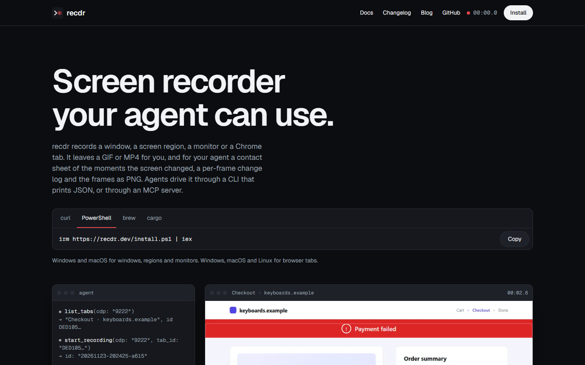

<div align="center">


# recdr.dev

**Screen recorder your agent can use.**

The site for [recdr](https://github.com/dzikrisyairozi/recdr): home page, docs, changelog and blog.

[Website](https://recdr.dev) · [Docs](https://recdr.dev/docs/) · [Changelog](https://recdr.dev/changelog/) · [Blog](https://recdr.dev/blog/) · [recdr on GitHub](https://github.com/dzikrisyairozi/recdr)

[](LICENSE)
[](https://github.com/dzikrisyairozi/recdr.dev/actions/workflows/ci.yml)
[](https://github.com/dzikrisyairozi/recdr/releases/latest)

<a href="https://recdr.dev"></a>

</div>

recdr records a window, a screen region, a monitor or a Chrome tab, and leaves files an AI agent can read: a GIF or MP4 for people, and for the agent a contact sheet of the moments where the screen changed, a per-frame change log and the stored frames as PNG. Its code lives in its own repository; this one holds only the site.

The site is a static Astro 7 build on Cloudflare Pages, with no server. It serves:

- the home page, with a real recdr recording (`src/assets/demo/`)
- `/docs/`, built with Starlight from the recdr README
- `/changelog/`, read from the GitHub releases at build time
- `/blog/`, with an RSS feed
- `/install.sh` and `/install.ps1`, which redirect to the install scripts of the latest recdr release
- a social card for every page, `/sitemap-index.xml` and `/llms.txt`

## Requirements

- Node 24.16 or later (`.node-version` holds the major version)
- pnpm 9

## Commands

```bash
pnpm install
pnpm dev              # dev server at http://localhost:4321
pnpm build            # static build to dist/
pnpm preview          # serve dist/ at http://localhost:4321
pnpm type-check       # astro check
pnpm lint             # ESLint
pnpm format           # Prettier, write
pnpm format:check     # Prettier, check
pnpm test             # unit tests (Node's test runner)
pnpm test:e2e         # Playwright, in Chromium and WebKit
pnpm lhci             # Lighthouse CI against dist/
pnpm check-all        # type-check, lint, format:check and test
```

`pnpm test:e2e` needs Playwright's browsers once per machine:

```bash
pnpm exec playwright install chromium webkit
```

## Project structure

```
astro.config.ts      site URL and integrations
public/              files served as they are: _redirects, robots.txt, favicon.svg
src/pages/           one file per route
src/layouts/         Site.astro, the document shell
src/components/      Astro components
src/lib/             pure TypeScript, each module with a *.test.ts next to it
src/scripts/         browser code, imported from a component's <script>
src/styles/          tokens.css (design tokens) and global.css
src/content/         Markdown for the docs and the blog
src/assets/demo/     one real recdr recording, shown on the landing page
demo/                the page that was recorded, and the script that records it
e2e/                 Playwright tests
```

## Deployment

Cloudflare Pages builds the `main` branch and gives every pull request from
this repository a preview URL.

| Setting          | Value                                              |
| ---------------- | -------------------------------------------------- |
| Build command    | `pnpm build`                                       |
| Output directory | `dist`                                             |
| `PNPM_VERSION`   | `9.6.0` (the build image's own pnpm is version 10) |
| `GITHUB_TOKEN`   | raises the GitHub API limit at build; set it       |

Node comes from `.node-version`. The redirect rules are in `public/_redirects`.
A local or preview build without network access still passes: the changelog
then links to the releases on GitHub. A production build (`CF_PAGES_BRANCH` is
`main`) fails when it cannot read the releases, and Cloudflare Pages keeps the
deployment before it. Without `GITHUB_TOKEN` the limit is 60 requests an hour
for each build machine's address.

## Contributing

See [CONTRIBUTING.md](CONTRIBUTING.md).

## License

MIT. See [LICENSE](LICENSE).
